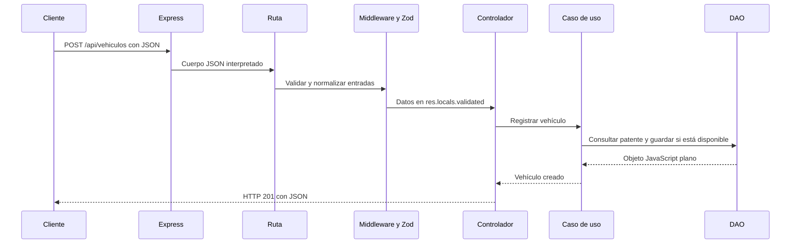
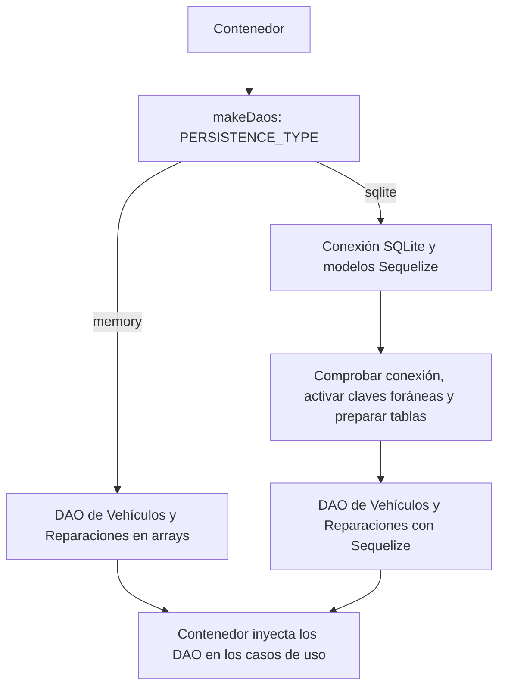

# Arquitectura del proyecto

La aplicación separa la comunicación HTTP, las reglas de negocio y el acceso a datos. Esto permite cambiar la persistencia sin modificar rutas, controladores ni casos de uso.

## Capas y responsabilidades

| Carpeta o archivo | Responsabilidad |
|---|---|
| `index.js` | Carga las variables de entorno e inicia el servidor con el puerto configurado, una vez preparada la aplicación. |
| `container/` | Selecciona los DAO mediante la factory, conecta las dependencias, crea Express y EventEmitter, registra el listener y monta rutas, Swagger y middlewares. |
| `routes/` | Define las rutas HTTP y conecta las validaciones con los controladores. |
| `schemas/` | Define con Zod los campos, tipos y restricciones de las entradas. |
| `middlewares/` | Valida entradas, informa rutas inexistentes y responde los errores con un formato JSON común. |
| `controllers/` | Recibe los datos validados, llama al caso de uso y envía la respuesta HTTP. |
| `usecases/` | Ejecuta operaciones y reglas, como verificar una patente única o impedir una finalización sin trabajo registrado. |
| `dao/` | Guarda y consulta datos en memoria o SQLite. Incluye la factory y los modelos con sus asociaciones centralizadas en `dao/models/index.js`. |
| `errors/` | Define `AppError`, con código, mensaje y estado HTTP. |
| `config/` | Centraliza variables de entorno, prepara SQLite y configura Swagger. |
| `listeners/` y `notifiers/` | Reciben eventos y realizan la notificación, separados de las reglas de negocio. |

El contenedor inyecta los DAO en los casos de uso y estos en los controladores. Los casos de uso no importan DAO concretos y los controladores no conocen los DAO.

## Recorrido de una petición

Ejemplo: registrar un vehículo con datos válidos.

Si una validación o una regla falla, el middleware centralizado devuelve el error. Se comprueba primero la entrada, luego la existencia y por último las reglas de negocio. Las rutas inexistentes pasan por `notFound`.

## Selección de persistencia

La factory `makeDaos` consulta `PERSISTENCE_TYPE` y entrega los DAO de Vehículos y Reparaciones. Ambos modos mantienen los mismos métodos y devuelven objetos planos; no entregan instancias de Sequelize a los casos de uso.

En SQLite, la factory espera la conexión y `sync()` antes de completar el contenedor. Después `index.js` inicia el servidor. No se utiliza sincronización destructiva. Un valor distinto de `memory` o `sqlite` impide el arranque con un error de configuración.

Sequelize representa las tablas mediante modelos y define la relación 1:N con `vehiculoId`. La base mantiene la unicidad de patente y las referencias entre entidades; los conflictos conocidos se traducen a `AppError`. Las reglas de negocio permanecen en los casos de uso.

## Evento y notificación

El contenedor crea EventEmitter, registra el listener e inyecta el bus en los casos de uso de Reparaciones. Después de guardar una transición efectiva a finalizada, el caso de uso emite `reparacion.finalizada` con una copia de la reparación.

El listener recibe el evento y llama a `notify` del notificador de consola. Captura tanto errores síncronos como rechazos de promesas, sin revertir el guardado ni hacer fallar la respuesta HTTP. Se puede sustituir el notificador desde el contenedor sin cambiar la regla de finalización.
